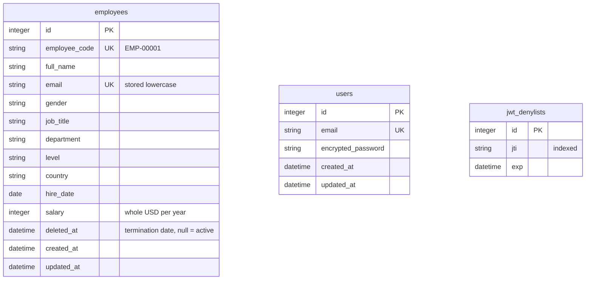

# Backend design (v1)

Scope is in [requirements.md](requirements.md) and reasoning in [decisions.md](decisions.md). This document covers the data model, API contract and build order for the Rails backend. It is written before any code. If implementation disagrees with it, update this file in the same commit.

## 1. Data model



`users` and `jwt_denylists` are unrelated to `employees`. HR users are not employees.

### 1.1 `employees`

| Column | Type | Constraints | Notes |
|---|---|---|---|
| `employee_code` | string | not null, unique | Human-facing ID, format `EMP-00001`. Immutable after creation. |
| `full_name` | string | not null | |
| `email` | string | not null, unique | Normalised to lowercase before validation, so uniqueness is case-insensitive. |
| `gender` | string | not null | Enum, see 1.3. |
| `job_title` | string | not null | Free text. |
| `department` | string | not null | Enum. |
| `level` | string | not null | Enum. |
| `country` | string | not null | Enum. |
| `hire_date` | date | not null | Not in the future. |
| `salary` | integer | not null | Annual, whole USD, greater than 0 and at most 10,000,000. No floats. |
| `deleted_at` | datetime | nullable | paranoia. `NULL` means active; a value is the termination date. |

**Validations (model):** presence of all columns above, email format and uniqueness, `salary` integer range, `hire_date` not in the future, inclusion of the enum values.

**Termination rules** (enforced in the `TerminateEmployee` service and a model guard):
- The termination date must be on or after `hire_date` and not in the future.
- A terminated employee cannot be updated or terminated again (error `employee_terminated`).

**paranoia notes:** `acts_as_paranoid` excludes terminated rows from `Employee` queries by default. The terminated view uses `Employee.only_deleted`. Single-record lookups for the API use `Employee.with_deleted` so a terminated employee can still be shown read-only. `restore` is never exposed.

### 1.2 Indexes

Each index is tied to a query we actually run.

| Index | Used by |
|---|---|
| unique `employee_code` | lookup and search by code |
| unique `email` | uniqueness validation |
| `deleted_at` | active vs. terminated list on every request |
| `country` | list filter and metrics grouping |
| `(country, salary)` | per-country median and top-paid |

Not indexed up front: `department` and `level` (low cardinality, so an index helps little at 10k rows) and the search columns. Search uses `LIKE '%q%'`, which can't use a B-tree index at all, and at 10k rows it's a fast scan. The performance slice verifies this with `EXPLAIN QUERY PLAN` and records the numbers, and an index is added only if the data justifies it.

### 1.3 Fixed lists (string-backed enums)

The database stores a **snake_case slug**, and the API's `/meta` endpoint supplies the display label. Slugs avoid awkward values like `"United States"` as enum keys.

| Field | Values (slug: label) |
|---|---|
| `country` | `india`, `united_states`, `united_kingdom`, `germany`, `canada`, `australia`, `singapore`, `brazil` |
| `department` | `engineering`, `sales`, `marketing`, `hr`, `finance`, `operations` |
| `level` | `junior`, `mid`, `senior`, `lead`, `principal` |
| `gender` | `female`, `male`, `non_binary`, `prefer_not_to_say` |

Level order (junior, then mid, and so on up to principal) is meaningful. The seed script and sort use it.

### 1.4 `users` and `jwt_denylists`

- `users`: standard Devise `database_authenticatable` columns (`email`, `encrypted_password`). No signup, `recoverable` or `registerable` modules. Users are created by the seed script only.
- `jwt_denylists`: `jti` (indexed) and `exp`. Logout writes the token's `jti` here and every request checks it. Token lifetime is 1 day. Expired rows can be purged.

## 2. API

Base path `/api/v1`. All requests and responses are JSON, apart from the CSV export. All endpoints except `login` require `Authorization: Bearer <token>`.

### 2.1 Conventions

**Employee object** (snake_case keys in v1; a camelCase transform is a one-line Alba option if the frontend prefers it):

```json
{
  "id": 42,
  "employee_code": "EMP-00042",
  "full_name": "Priya Sharma",
  "email": "priya.sharma@acme.test",
  "gender": "female",
  "job_title": "Backend Engineer",
  "department": "engineering",
  "level": "senior",
  "country": "india",
  "hire_date": "2021-03-15",
  "salary": 38500,
  "terminated_on": null
}
```

`terminated_on` is the date part of `deleted_at`, and `null` for active employees. `deleted_at` is not exposed.

**List envelope:**

```json
{ "data": [ /* employees */ ],
  "meta": { "page": 1, "per_page": 25, "total_count": 10000, "total_pages": 400 } }
```

**Error envelope** (all non-2xx):

```json
{ "error": { "code": "validation_failed",
             "message": "Validation failed",
             "details": { "email": ["has already been taken"], "salary": ["must be greater than 0"] } } }
```

| HTTP | `code` | When |
|---|---|---|
| 401 | `unauthorized` | Missing, invalid, expired or revoked token; bad login credentials |
| 404 | `not_found` | Unknown employee id |
| 422 | `validation_failed` | Field errors, listed per field in `details` |
| 422 | `employee_terminated` | Update or terminate on an already-terminated employee |
| 422 | `invalid_param` | Unknown enum value in a filter, unknown `sort` field, `per_page` out of range |

### 2.2 Auth

| Method and path | Body | Success |
|---|---|---|
| `POST /api/v1/login` | `{ "user": { "email": "...", "password": "..." } }` | 200. The JWT is in the `Authorization: Bearer ...` **response header**, and the body is `{ "user": { "id", "email" } }` |
| `DELETE /api/v1/logout` | none | 204. The token's `jti` is added to the denylist. |

Bad credentials return 401 `unauthorized`.

### 2.3 Employees

| Method and path | Purpose | Success |
|---|---|---|
| `GET /api/v1/employees` | Paginated list | 200, list envelope |
| `GET /api/v1/employees/:id` | One employee (active or terminated) | 200, employee object |
| `POST /api/v1/employees` | Create | 201, employee object |
| `PATCH /api/v1/employees/:id` | Update | 200, employee object |
| `POST /api/v1/employees/:id/terminate` | Terminate | 200, employee object with `terminated_on` set |
| `GET /api/v1/employees/export` | CSV of the filtered result | 200, `text/csv`, same params as the list except pagination |

**List params:**

| Param | Values | Default |
|---|---|---|
| `status` | `active`, `terminated` | `active` |
| `q` | Text, matched case-insensitively against name, email and employee code | none |
| `country`, `department`, `level` | Enum slug | none, combinable |
| `sort` | `full_name`, `salary`, `hire_date`, plus `terminated_on` when `status=terminated` | `full_name` |
| `direction` | `asc`, `desc` | `asc` |
| `page` | Integer greater than or equal to 1 | `1` |
| `per_page` | 1 to 100 | `25` |

Ordering always ends with `id` as a tiebreaker, so pagination is stable.

**Create or update body:** `{ "employee": { full_name, email, gender, job_title, department, level, country, hire_date, salary } }`. `employee_code` is assigned by the server on create (next in the `EMP-%05d` sequence) and is not editable. A `PATCH` accepts a partial body.

**Terminate body:** optional `{ "terminated_on": "2026-10-09" }`, defaulting to today. See the date rules in 1.1.

**CSV export:** a header row followed by one row per employee, with human-readable labels (for example `United States`) in place of slugs. Rows are streamed in batches (`find_each`-style) so 10k rows don't sit in memory. The same ordering rules apply as for the list.

### 2.4 Meta

`GET /api/v1/meta` returns the fixed lists, so the frontend never hardcodes them:

```json
{ "countries":   [ { "value": "united_states", "label": "United States" }, ... ],
  "departments": [ { "value": "engineering",   "label": "Engineering" }, ... ],
  "levels":      [ ... ],
  "genders":     [ ... ] }
```

### 2.5 Metrics (provisional)

`GET /api/v1/metrics/countries` returns one row per country with `headcount`, `median_salary`, `total_payroll`, and `top_paid` (employee id, name, level and salary). It counts **active employees only**. The median is computed in SQL with window functions. The exact shape and any filters are settled when this slice is built, and this section is updated then.

## 3. Code layout

```
app/
  controllers/api/v1/   # thin: auth, params, render
  models/               # Employee, User, JwtDenylist: validations, enums, scopes
  queries/              # EmployeeSearch (search, filter, sort); SalaryMetricsByCountry
  services/             # TerminateEmployee, CreateEmployee (code generation), EmployeeCsvExport
  serializers/          # Alba resources: EmployeeSerializer, ...
db/seeds.rb             # deterministic: 10k employees and HR users
```

## 4. Seed data

`salary = level_base × country_multiplier × random(0.85..1.15)`, rounded to the nearest 100, with `Random.new(42)` so every run is identical.

| Level | Base (USD) | Share of headcount |
|---|---|---|
| junior | 60,000 | 30% |
| mid | 85,000 | 30% |
| senior | 120,000 | 22% |
| lead | 150,000 | 12% |
| principal | 190,000 | 6% |

| Country | Multiplier | Share of headcount |
|---|---|---|
| india | 0.30 | 30% |
| united_states | 1.00 | 22% |
| united_kingdom | 0.75 | 12% |
| germany | 0.80 | 10% |
| canada | 0.85 | 8% |
| australia | 0.85 | 7% |
| singapore | 0.80 | 6% |
| brazil | 0.40 | 5% |

Departments are weighted too (for example, Engineering and Sales are the largest). A small share (about 3%) of employees are seeded as already terminated, with plausible dates, so the terminated view is populated. Inserts use `insert_all` in batches. Names and emails come from fixed lists built with the seeded RNG, so there are no extra gems and no random output. The seed also creates 2 or 3 HR users from env-configurable credentials.

## 5. Build order (backend slices)

Each slice follows tests first, then a migration made with the generator, then the review and commit steps in `CLAUDE.md`.

1. **Tooling:** RSpec, FactoryBot, shoulda-matchers and the stack gems. No features.
2. **Employee model:** enums, validations, indexes, factory and model specs.
3. **Auth:** `users`, Devise JWT login/logout, denylist, request specs, and the error envelope for 401.
4. **List:** `GET /employees` with `EmployeeSearch`, Kaminari, Alba serializer, and the list envelope.
5. **Create, show and update:** including code generation and validation errors.
6. **Terminate:** the service, the read-only rule, and `status=terminated` on the list.
7. **Meta and CSV export.**
8. **Seed script:** 10k employees, timed, with a spec for the salary generator.
9. **Metrics:** SQL median and the endpoint. Finalise 2.5.
10. **Performance pass and README:** `EXPLAIN` results, timings, run and deploy notes.

## 6. Notes for later phases

- **CORS:** the React app on another origin needs `rack-cors`, with `Authorization` exposed in responses. That's a new gem, so it's raised at the start of frontend work.
- **Downloading the CSV** needs the auth header, so the frontend fetches it as a blob rather than using a plain link.
